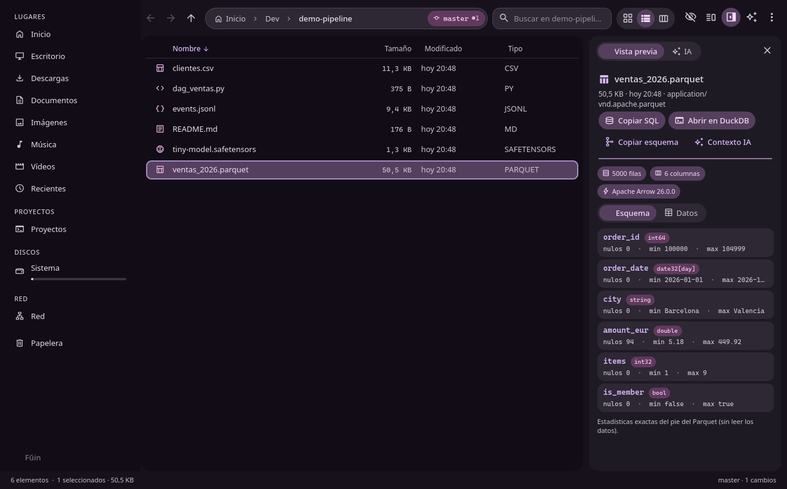

# Fūin

**Gestor de archivos rápido y pensado para el teclado, hecho con Qt 6 Quick y KIO de KDE, con vista
previa de datos y modelos de ML, paquetes de contexto para chats con IA en una tecla y un servidor MCP
para que los agentes de programación vean (y, con tu permiso, modifiquen) la carpeta que estás mirando.**

> 🇬🇧 [Read in English](README.md)

*Fūin* (封印, «sello») es la técnica de sellado de Naruto con la que se guardan cosas dentro de pergaminos:
aquí, tus ficheros.



## Funciones

- **Gestión de archivos con KIO**: pestañas, vista dividida (F3) con copiar/mover al otro panel (F5/F6),
  cuadrícula · lista · columnas, barra de ruta editable (Ctrl+L) con autocompletado, cualquier URL de KIO
  (`sftp://`, `smb://`, `mtp:/`, `trash:/`…), discos con barra de uso y montar/expulsar (Solid), miniaturas,
  copiar/mover/papelera con progreso y **deshacer** (Ctrl+Z), arrastrar y soltar, *Abrir con…*,
  filtro al escribir, búsqueda recursiva con `fd`, insignias de git (rama y cambios).
- **Vista previa**: código con resaltado, Markdown, imágenes, vídeo y PDF; **tablas** CSV/TSV/JSON/JSONL/**Parquet**
  con esquema, filas, nulos y mín/máx (en Parquet, exactos del pie del archivo) más *Copiar SQL* y *Abrir en DuckDB*;
  **modelos** safetensors, GGUF y ONNX (parámetros, tipos, cuantización) sin cargar los pesos.
- **IA**:
  - **Contexto para IA** (Ctrl+Mayús+I): empaqueta la selección o la carpeta en un único Markdown o XML
    (árbol + archivos), respeta `.gitignore`, incluye **el esquema en lugar de los datos** para Parquet/CSV grandes
    y modelos, y estima los tokens. También como `fuin --context`.
  - **Servidor MCP** (`fuin --mcp`) para Claude Code, Cursor, etc.: vista actual y selección, listar, leer,
    buscar, inspeccionar datos/modelos, contexto y mostrar archivos. La escritura está **desactivada** por defecto;
    si la activas, cada cambio te pide confirmación en la ventana y se puede deshacer.
  - **Guardia de secretos**: `.env`, claves y tokens llevan una 🔑 y nunca se envían a la IA.
- **Estética**: tarjetas redondeadas, colores Material 3. Colores en vivo opcionales desde un JSON de
  [matugen](https://github.com/InioX/matugen) (transición suave al cambiar el fondo); si no, un tema oscuro integrado.

## Instalación (Arch Linux)

```sh
sudo pacman -S --needed base-devel cmake ninja extra-cmake-modules qt6-base qt6-declarative qt6-svg \
  kio kio-extras solid kcoreaddons kservice syntax-highlighting ttf-material-symbols-variable
sudo pacman -S --needed arrow fd ripgrep git duckdb kdegraphics-thumbnailers ffmpegthumbs kimageformats plasma-activities-stats  # opcional
cmake -S . -B build -G Ninja -DCMAKE_BUILD_TYPE=Release -DCMAKE_INSTALL_PREFIX=$HOME/.local
cmake --build build && cmake --install build
```

> **Nota (Arch):** si una actualización cambia el *soname* de Arrow (p. ej. `libarrow.so.2500` → `.2600`),
> Fūin deja de arrancar con «cannot open shared object file»: vuelve a compilar e instalar con los comandos de arriba.

Otras distribuciones: CMake ≥ 3.22, C++20, Qt ≥ 6.6, KDE Frameworks 6 (KIO, Solid, CoreAddons, Service) y la
fuente *Material Symbols Rounded*. Detalles en el [README en inglés](README.md#from-source-any-distro).

## Uso

```sh
fuin ~/Dev                      # abrir
fuin --reveal ~/datos.csv       # abrir su carpeta y seleccionarlo
fuin --context . | wl-copy      # paquete de contexto al portapapeles
claude mcp add --scope user fuin -- fuin --mcp   # conectar Claude Code
```

Configuración en `~/.config/fuin/fuin.conf` (terminal, editor, archivo de colores, animaciones,
carpetas de proyectos, raíces y escritura MCP); ver el [README en inglés](README.md#configuration).

## Licencia

[MIT](LICENSE).
